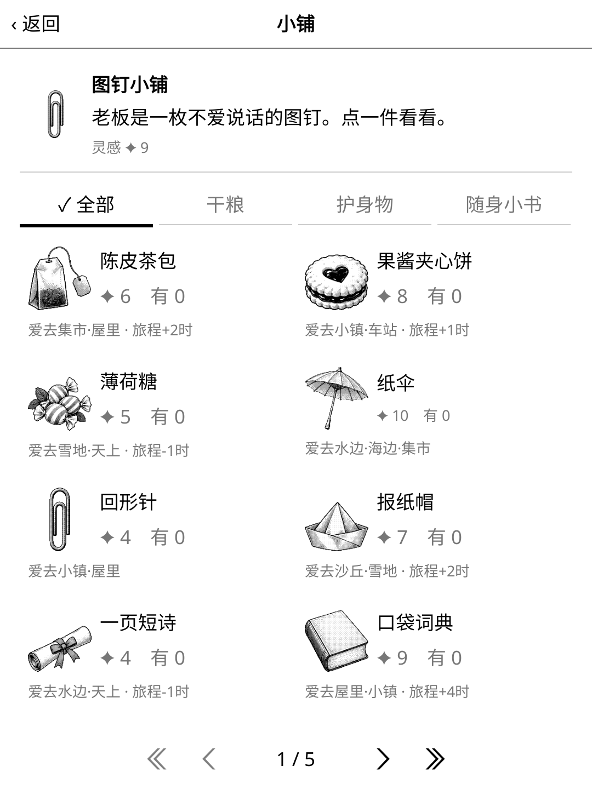
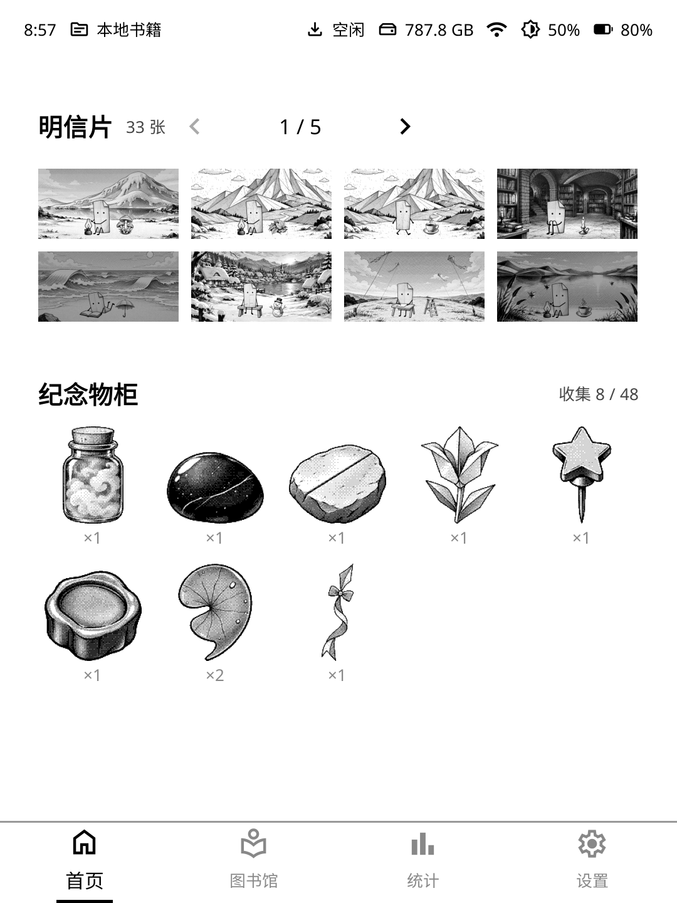

<p align="center">
  
</p>

# 阿页的阁楼 · ko-paper-sprite

[](https://github.com/AnkioTomas/ko-paper-sprite/actions/workflows/ci.yml)

一个住在阅读器里的小纸灵。KOReader 插件，同时也是[月读](https://github.com/AnkioTomas/moon)扩展。完全离线，为墨水屏设计。

<p>
  
  
  
  
</p>

## 这是什么
书页里住着 **阿页**：一张旧书签变成的小纸灵，折纸身子，头上翘着一个书角。它住在一间小阁楼里，有书桌、油灯、藤筐，还有一面贴明信片的墙。

- **收拾行囊**：往藤筐里放一样干粮、一样护身物、一本随身小书。带什么决定它爱去哪儿、去多久。
- **自己出门**：收好行囊后过一阵它会悄悄出发，留下一张纸条。旅程按真实时间计，几小时到一天多。
- **寄回明信片**：路上寄回黑白明信片。地点都在书中世界（墨水湖、折页山、烛光书窖……），由背景、姿势、小物、天气、短句分层合成，组合上千种。
- **带回特产**：回家时带回小物件，收进特产柜，还能摆进阁楼。
- **访客**：墨点虫、印泥熊等小客人偶尔来串门，走时留点灵感。
- **灵感**：在 KOReader 里读书翻页攒灵感，到小铺换干粮和护身物。
- **最近**：阁楼里记着阿页出门、回家、来客、收到明信片的时间。
- **可选 AI 文案**：在月读里且已配置 AI 时，明信片短句和旁白可以由 AI 现写，见 [docs/ai.md](docs/ai.md)。
- 没有失败和惩罚，不需要每天打卡。

## 界面
- 全屏界面支持 KOReader 原生和月读主题两套皮肤，卡片无边框，翻页用页脚加左右滑动，每页条数按屏幕高度自动调整。
- KOReader 顶部菜单里多一个「阿页」页签（阅读器和文件管理器都有），能看阁楼近况，也有快捷入口。
- 月读首页组件：「阿页」近况卡片、「阿页的阁楼」、「阿页的明信片」（列表 / 迷你墙）、「纪念物柜」，各有小 / 中 / 大三种尺寸。



## 安装
### KOReader
1. 在 [Releases](https://github.com/AnkioTomas/ko-paper-sprite/releases) 下载 `paper-sprite.koplugin-<版本>.zip`。
2. 解压后把 `paper-sprite.koplugin` 目录复制到 KOReader 的 `plugins/` 下（如 Kindle 上的 `koreader/plugins/`）。
3. 重启 KOReader。从顶部菜单的「阿页」页签，或「工具 → 阿页的阁楼」打开。

### 月读
同一个插件就能用，不需要另装。月读设置的「系统」里有「阿页的阁楼（版本号）」页，可开关自动检查更新、手动检查并一键更新。启用月读和本插件后，在月读首页编辑状态下点「添加组件」，加入「阿页」系列组件；点组件会全屏打开阁楼。

存档保存在 KOReader 数据目录下的 `.moon/game/paper-sprite/`（`save.lua` 存档与设置、`reading.lua` 阅读账本），KOReader 和月读共用，更新插件不会丢。旧版本的存档会在第一次打开时自动复制过来，旧文件原样保留作备份。

## 开发
```
lua spec/run.lua                                   # 虚拟时钟冒烟测试
find paper-sprite.koplugin spec -name '*.lua' -exec luac -p {} +
tools/release.sh 1.0.1                                  # 更新 CHANGELOG、用 tools/package.sh 注入版本号并打包到 dist/、提交并打 tag
```
推送 `v*` tag 后，GitHub Actions 会跑测试、打包，并创建 Release。

文档：[世界设定](docs/world.md) · [玩法与数值](docs/gameplay.md) · [架构](docs/architecture.md) · [数据格式](docs/data-format.md) · [素材规格](docs/assets.md) · [测试](docs/testing.md) · [首页组件与皮肤](docs/widgets.md) · [路线图](docs/roadmap.md) · [更新日志](CHANGELOG.md)

## 协议与致谢
- 代码以 MIT 协议发布，见 [LICENSE](LICENSE) / [NOTICE](NOTICE)。
- 角色、地点、物品、文案与数值全部原创。
- 美术原创：插画由作者按原创设定用 Teamo 图像生成后，经 `tools/process_art.py` 处理成墨水屏 4 级灰；天气层由程序生成。未使用任何第三方作品或素材。
- 本项目是独立作品，与任何游戏、公司或品牌无关联。
